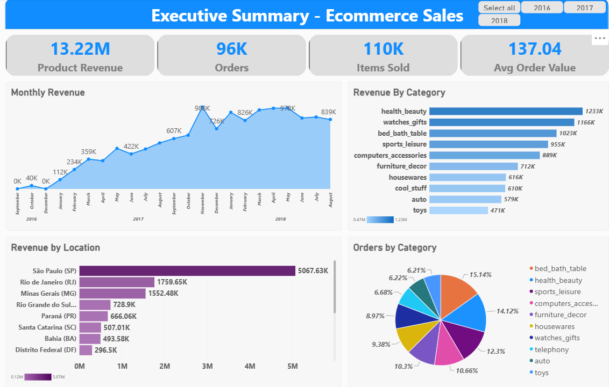
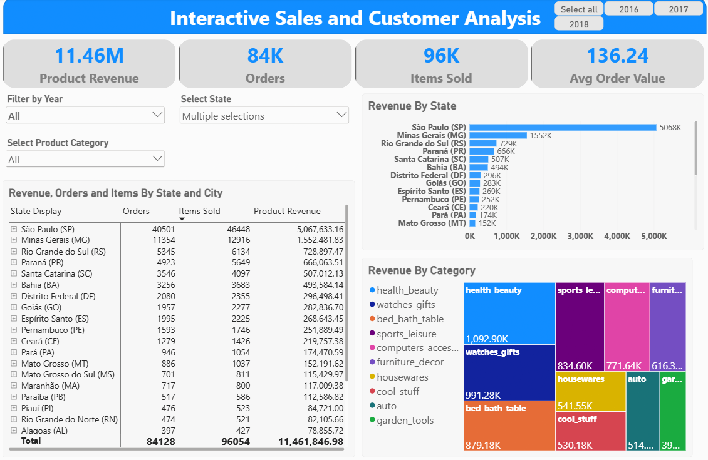
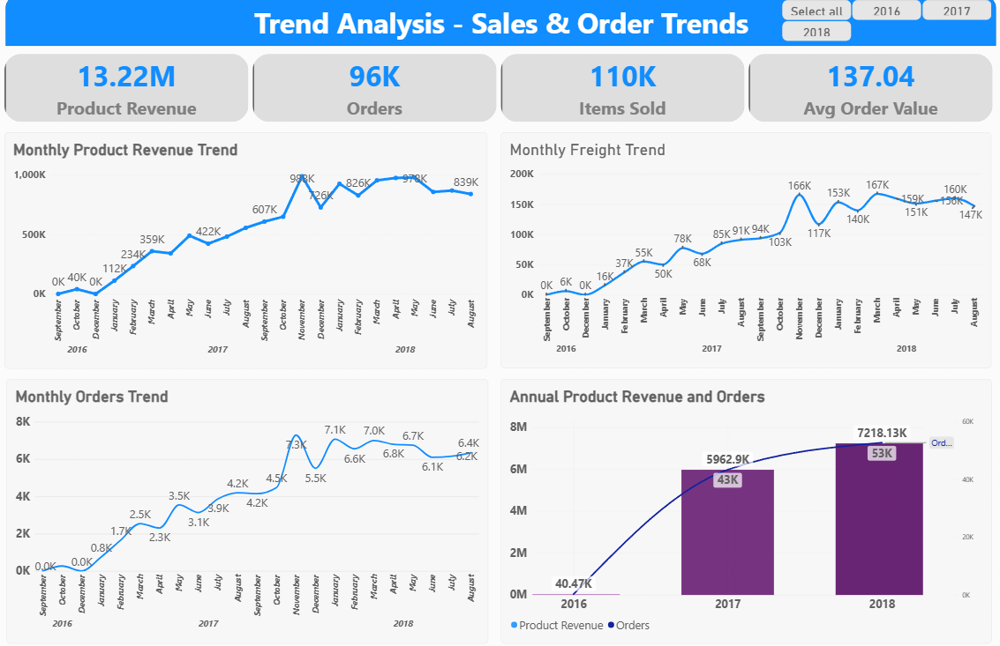

# Olist E-Commerce Data Warehousing & Business Intelligence

## Project Overview

This university group project focuses on developing a Data Warehouse and Business Intelligence solution using the Olist Brazilian E-Commerce dataset.

The project involves data integration, ETL processing, dimensional modelling, data mart development and interactive business intelligence reporting using Microsoft Power BI.

The objective is to transform raw e-commerce data into structured information that supports sales analysis and business decision-making.

## My Individual Contributions

### 1. ETL Development
- Developed ETL processes to extract data from staging tables.
- Performed data transformation and cleaning using SQL.
- Loaded transformed data into the data warehouse.
- Supported data consistency and validation during the ETL process.

### 2. Data Mart Development
- Developed analytical data marts using SQL.
- Aggregated sales information to support business reporting.
- Prepared structured datasets for business intelligence analysis.

### 3. Power BI Dashboard Development
- Collaborated with team members on Power BI dashboard development.
- Helped create and improve data visualisations.
- Supported the presentation of sales trends and business performance indicators.

## Technologies Used

- Microsoft SQL Server
- SQL Server Management Studio (SSMS)
- SQL
- Microsoft Power BI
- ETL
- Dimensional Modelling
- Data Warehousing
- Business Intelligence

## Dataset

**Olist Brazilian E-Commerce Dataset**

The dataset contains information about customer orders, products, sellers and e-commerce transactions.

Dataset source: [Olist Brazilian E-Commerce Public Dataset](https://www.kaggle.com/datasets/olistbr/brazilian-ecommerce)

## Project Workflow

1. Import source datasets into SQL Server staging tables.
2. Clean and transform source data through ETL processes.
3. Load processed data into the dimensional data warehouse.
4. Develop data marts for analytical reporting.
5. Connect the analytical data to Power BI.
6. Create dashboards to visualise business performance.

## Power BI Dashboard Preview

### Executive Summary

### Interactive Analysis

### Trend Analysis

## Project Files

- `SQL/` — SQL scripts used in the data warehousing project.
- `PowerBI/` — Power BI dashboard.
- `Screenshots/` — Dashboard screenshots.

## Team Project Acknowledgement

This project was completed collaboratively as part of a university assignment.

My primary responsibilities were ETL development and data mart implementation. I also contributed to Power BI dashboard development alongside my teammates.
